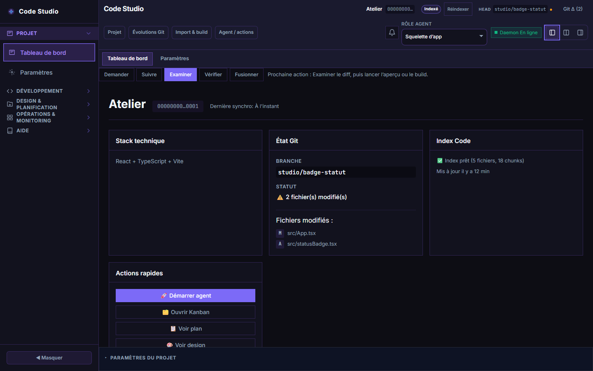
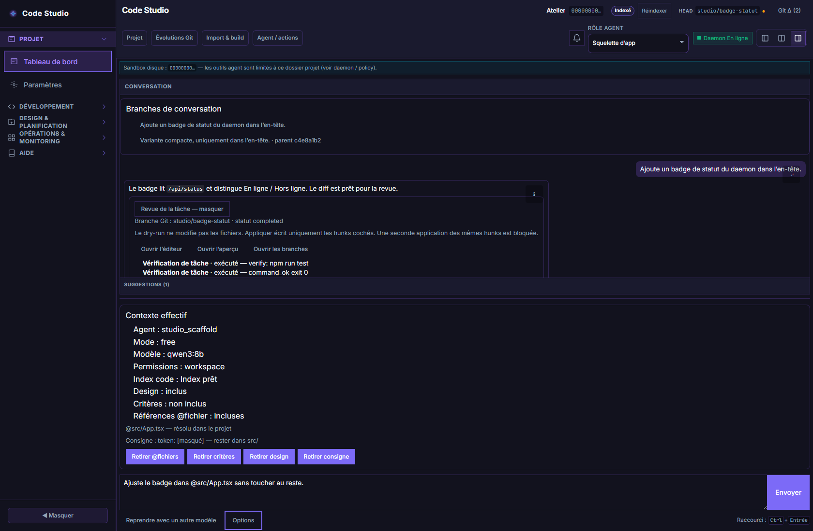
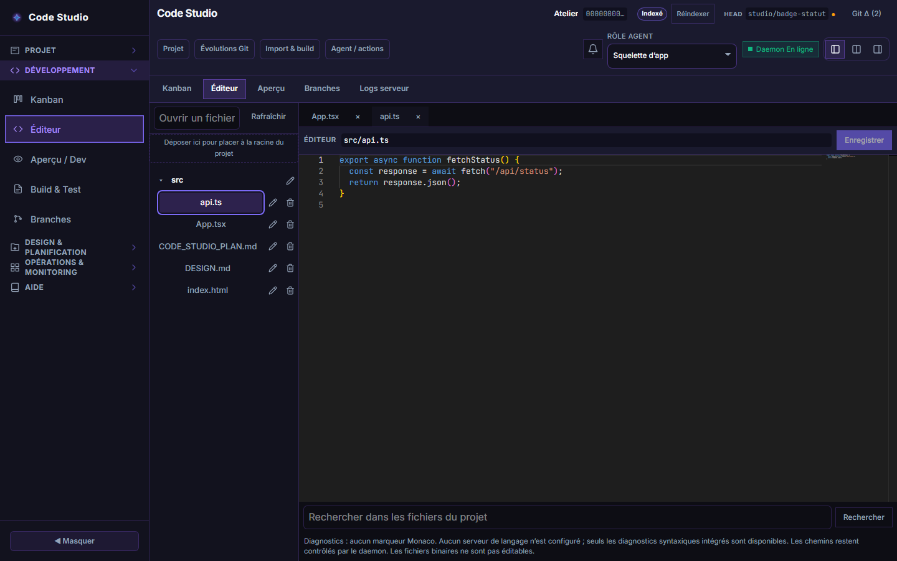
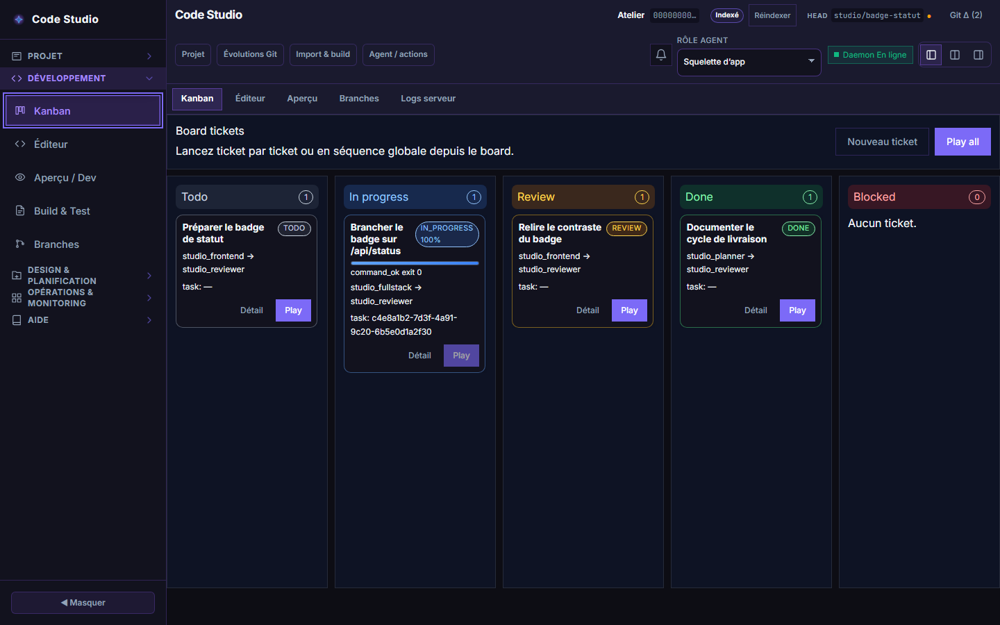
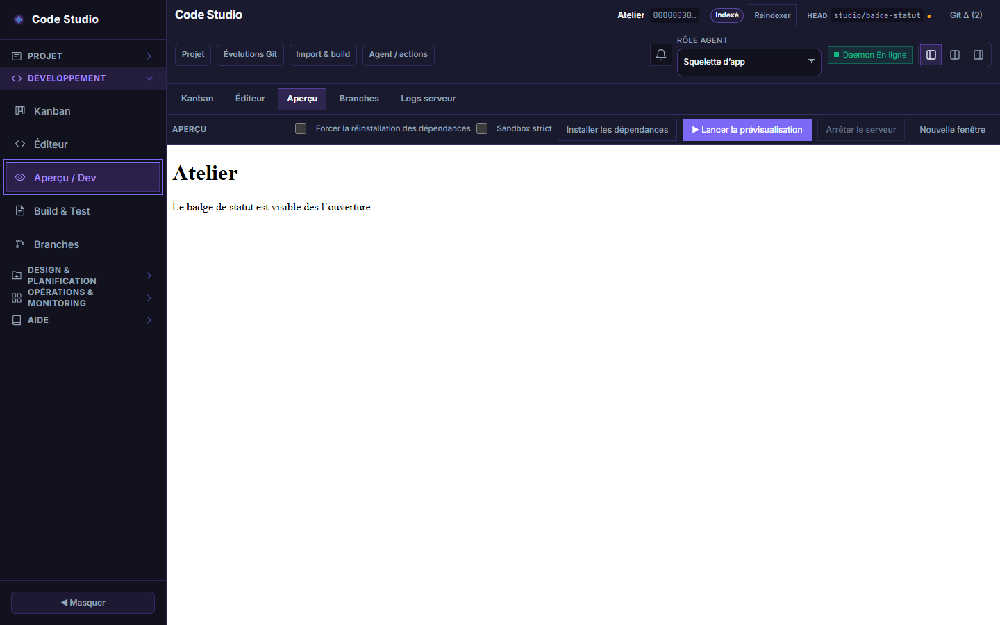
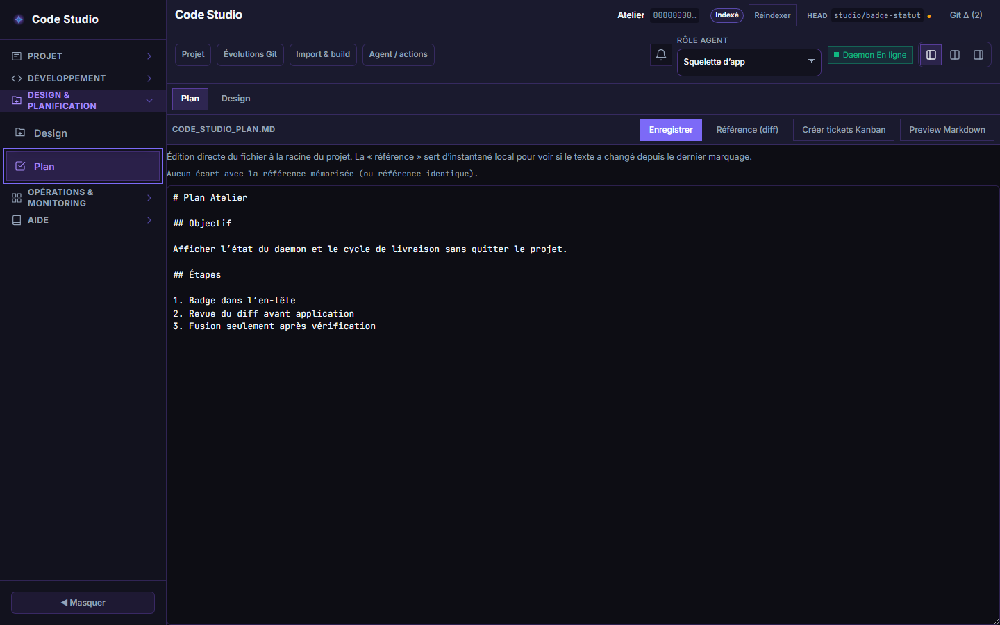
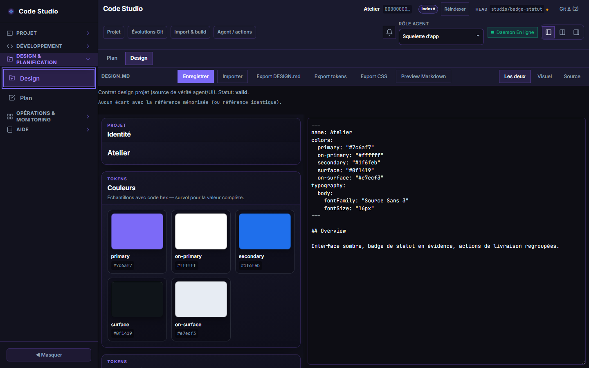
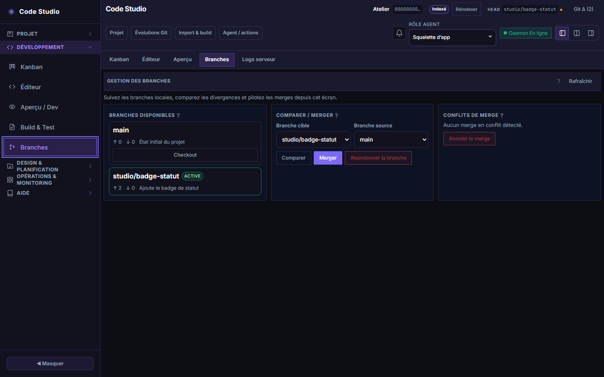
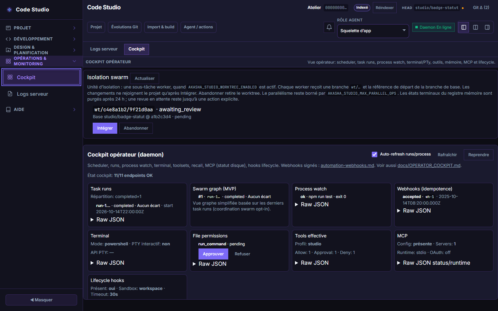
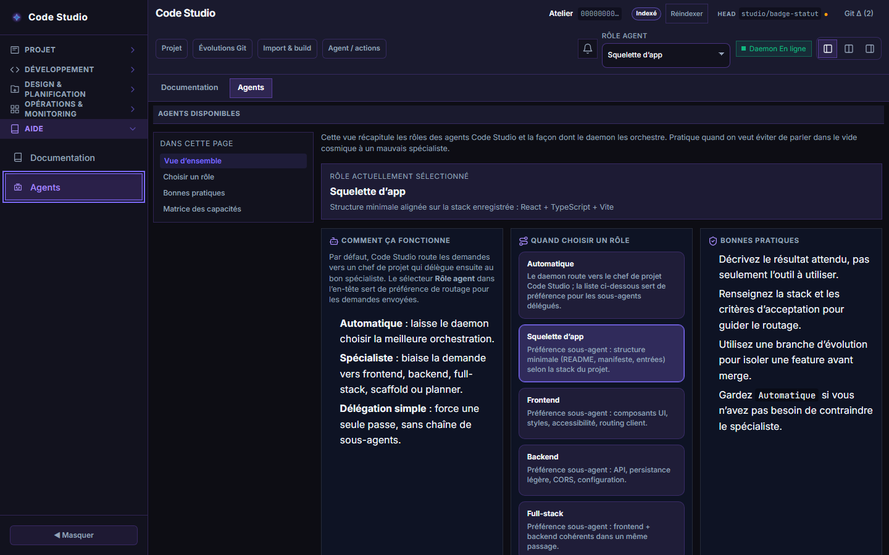

# Akasha Code Studio

Interface web du mode Code Studio. Elle pilote un projet isolé par le daemon Akasha : demande à un agent, édition des fichiers, aperçu, branches Git et suivi d’exécution.

Le daemon Akasha 0.12.0 écoute par défaut sur `http://127.0.0.1:3876`. L’interface de développement est sur `http://127.0.0.1:5178` et proxifie `/api` vers ce daemon.

## Démarrer

Prérequis : Node.js 22.12+, 24.x ou 26+, le daemon Akasha déjà lancé, Git si vous utilisez les évolutions.

```bash
npm install
npm run dev
```

Ouvrez `http://127.0.0.1:5178`. Le badge d’en-tête passe à **Daemon En ligne** quand `GET /api/status` répond. Si le daemon n’est pas sur le port 3876, définissez `VITE_DAEMON_URL` avant `npm run dev`.

Le parcours habituel : créer ou charger un projet, envoyer une demande, examiner le diff, vérifier dans l’aperçu, puis fusionner la branche.

## Fonctionnalités

### Cycle de livraison

Le tableau de bord garde le fil : demander, suivre, examiner, vérifier, fusionner. Il affiche la stack, la branche Git, l’index de code et l’action suivante.



### Conversation, revue et contexte

Le chat montre les branches de conversation sans remplacer le fil en cours. La revue d’une tâche regroupe le statut, les vérifications et le diff. Avant l’envoi, le résumé de contexte indique l’agent, le modèle, les permissions, l’index, les fichiers `@chemin` et masque les secrets.



### Éditeur

Plusieurs fichiers restent ouverts. L’ouverture rapide, la recherche dans le projet et les diagnostics Monaco sont dans le même écran. Aucun serveur de langage n’est branché.



### Kanban

Les tickets avancent de Todo à Done. Une tâche liée affiche sa progression, et chaque carte se lance vers l’agent assigné.



### Aperçu

Un fichier HTML s’affiche sans serveur. Le bouton de prévisualisation installe les dépendances détectées puis lance le serveur de dev du projet.



### Plan et design

`CODE_STUDIO_PLAN.md` se rédige dans l’onglet Plan. `DESIGN.md` alimente les jetons de couleur et la source que l’agent peut recevoir.





### Branches

Les branches locales, l’avance et le retard, la comparaison et le merge sont dans le même écran.



### Cockpit

Quand `AKASHA_STUDIO_WORKTREE_ENABLED` est actif, chaque sous-tâche worker reste sur une branche `wt/…` jusqu’à **Intégrer** ou **Abandonner**. Le cockpit opérateur montre en plus le planificateur, les runs, les outils, les permissions et MCP.



### Agents

La matrice décrit ce que chaque rôle peut faire, et ce qu’il ne fait pas. Le sélecteur d’en-tête fixe le rôle préféré pour la prochaine demande.



Les paramètres d’apparence, de conversation et de journal de build sont dans **Paramètres**. Ils restent dans le navigateur.

## Tests

```bash
npm run test
npm run test:e2e
npm run test:daemon
```

`npm run test:daemon:task` envoie une vraie tâche au daemon. Il ne part que si `CODE_STUDIO_E2E_TASK=1` est défini, ce que fait `vitest.daemon-task.config.ts`.

## Documentation

- [Guide utilisateur](docs/USER_GUIDE.md)
- [Spécification](docs/CODE_STUDIO_SPEC.md)
- [Cockpit opérateur](docs/OPERATOR_COCKPIT.md)
- [Frontières des modules](docs/UI_BOUNDARIES.md)

Les captures de ce README se régénèrent avec `npm run dev` déjà lancé :

```bash
node scripts/capture-readme-screenshots.mjs
```
