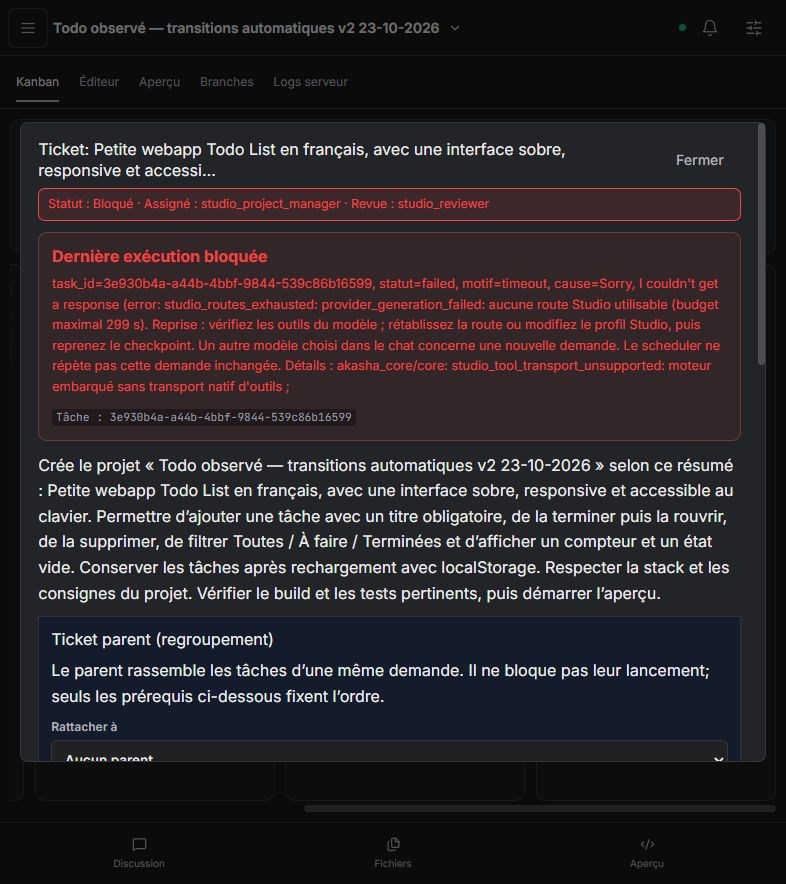

# Lectures, transitions de phase et Vitest — 23 octobre 2026

## Livraison

Changements poussés dans les PR existantes, conservées ouvertes :

- [Akasha #259](https://github.com/azerothl/Akasha/pull/259) : `a9b5e79`, puis `a959260`.
- [Code Studio #114](https://github.com/azerothl/Akasha-code-studio/pull/114) : `4428654`, puis `ebb21f5`, avec les recettes et le contrat.
- Ordre : **Akasha #258 → #259 ; Code Studio #113 → #114 ; daemon #259 disponible avant UI #114**. Aucune fusion ni fermeture de ticket au titre de cette recette.

## Corrections

### Lectures sans progression

Les spécialistes d'exécution ont maintenant un compteur persistant dès leurs premières inspections. Huit demandes d'inspection sans mutation ou nouveau résultat de vérification, ou trois demandes identiques consécutives, activent une frontière d'action. Le comptage précède les anciens contrôles qui peuvent déjà refuser une relecture : les appels refusés ne disparaissent plus du diagnostic de stagnation.

Les outils de modification et de vérification restent soumis aux permissions habituelles ; les nouvelles inspections sont refusées. Trois refus entraînent un arrêt explicite. Une écriture sans changement ou un build répété sur la même révision ne réinitialise pas le contrôle. Les lectures ciblées des réparateurs restent possibles, les reviewers gardent leur rôle de lecture seule. Ce contrôle vise les spécialistes d'exécution ; il ne mesure pas encore la progression sémantique des modifications du Kanban par le coordinateur.

### Passage à la phase suivante

- Le plan initial se termine dès que le tableau persistant satisfait les contrôles de critères, rôles et dépendances. Le scheduler lance ensuite les tickets prêts ; aucune génération de clôture ou délégation supplémentaire n'est nécessaire.
- Le ticket de socle fourni est reconnu par son lien système, son parent et la filiation réelle de la tâche. Il vérifie la commande configurée, sans implémenter le produit ni recréer son infrastructure.
- Après un build frais réussi, le runtime ajoute la mise en revue du ticket au même circuit d'outils, avec les contrôles de rôle, politique, reçus et checkpoint. Aucun second appel LLM n'est nécessaire pour cette transition mécanique.
- Le circuit de réparation reste disponible si le build échoue. Le passage en revue ne ferme pas le ticket : la revue reste nécessaire avant de débloquer ses dépendances, et les fonctionnalités du produit restent à implémenter.
- La consigne initiale interdisant aux spécialistes de mettre à jour leur suivi a été remplacée par une consigne de consignation des preuves et de passage en revue.

### Configuration Vitest du socle v2

Configuration unique `vitest.config.ts` à la racine, environnement jsdom, Testing Library, vrais types Vitest/jest-dom et nettoyage du DOM entre tests. Les fichiers `.test.ts` et `.test.tsx` restent dans TypeScript strict. Aucune assertion métier n'est préécrite et aucun contrôle n'est affaibli. Les dépendances sont verrouillées ; Node requis pour ce socle : `^22.13.0 || ^24.0.0 || >=26.0.0`.

## Validations techniques

| Périmètre | Résultat | Portée |
| --- | --- | --- |
| Daemon, bibliothèque CPU embedded | 708 réussis, 1 ignoré | Test PTY ignoré ; CUDA non validé |
| UI, tests unitaires | 41 réussis | Sans LLM réel |
| Playwright UI | 52 réussis | API simulée |
| Build UI | Réussi | Avertissement de taille du bundle existant |
| Création via daemon final | 1 réussi, 1 ignoré | Vérifie création/Git, pas l'autonomie LLM |
| Recettes agentiques filtrées | 11 réussies | Fournisseur scripté, vrais fichiers et processus |

La suite agentique complète n'a pas été rejouée. Le groupe filtré couvre les deux transitions sans génération supplémentaire, la progression après relectures, deux tests DOM avec matchers et compilation TSX stricte, l'installation automatique, la réparation de conflit npm, les erreurs TypeScript, une panne de registre et le refus d'un faux succès via un build affaibli.

CI consultée avant le commit du rapport : Code Studio `ebb21f5` réussi sur Linux et Windows. Pour Akasha `a959260`, Rust, embedded Linux et évaluations mockées réussis ; parcours UI encore en cours et GPU en attente. Aucun échec CI observé à cette consultation. Le commit des preuves déclenche une nouvelle CI UI ; ces statuts ne constituent pas une validation de la Todo réelle.

Les tests intermédiaires ont aussi permis de corriger la liaison coordinateur/spécialiste et le comptage des inspections refusées. La fixture a été adaptée pour ne pas consommer une réponse destinée au spécialiste dans la continuation de son parent ; les événements `llm_call_started` seuls ne comptent pas nécessairement le premier appel, d'où l'assertion sur les requêtes réelles de la fixture pour le plan.

## Protocole réel

Deux créations depuis l'interface Code Studio, une seule demande initiale par projet. Même demande : Todo française avec ajout obligatoire, terminer/réouvrir, suppression, filtres, compteur, état vide, localStorage, clavier/responsive, tests/build puis aperçu. Profil Automatic Studio inchangé ; appels réels Ollama, modèle observé Qwen3.5 9B. Les diagnostics de route enregistrent également la qualification GPT-OSS 20B et le refus du transport natif du moteur core ; une erreur de protocole ne prouve pas une panne réseau ou un défaut de permissions.

**Aucun fichier du projet corrigé à la main, aucun prompt supplémentaire, aucun retry, install, build ou lancement d'aperçu manuel pendant le travail des agents.** Les corrections du produit et redémarrages ont eu lieu entre des exécutions terminales. Les reprises du scheduler sont autonomes. Le socle Vite fourni par l'hôte reste une infrastructure, pas une application Todo livrée.

Les observations API et les opérations conservées sont bornées ; elles ne constituent pas une trace exhaustive. Les [preuves JSON](inspection-handoff-vitest-real-2026-10-23.json) donnent les dates, versions du binaire, tâches, tableau et contrôles disque.

### Premier projet — avant le complément de transition mécanique

Projet `deff0da5-453f-4b7f-957a-dc8595fe2db5`, daemon `a9b5e79`.

- Coordinateur : 9 opérations réussies, 0 outil exécuté en échec, puis arrêt de route après proposition de `delegate_to_agent` non annoncée pour la planification. La terminaison expose aussi les délais de qualification des routes de secours.
- Le scheduler lance seul le spécialiste du socle : tâche `9da17e75-033b-4e22-9db6-66c73fae23eb`. L'installation et le build réels réussissent, puis Qwen ne produit pas l'appel complet requis pour mettre le ticket en revue. 2 opérations réussies ; aucun travail applicatif.
- Ce résultat a motivé le complément `a959260` : transitions mécaniques issues des preuves, sans nouveau tour LLM. Le premier projet n'a pas été corrigé manuellement ni réutilisé pour simuler une réussite.

### Second projet — daemon final

Projet `3c93110c-e1ee-413a-b9cb-160f4174024e`, daemon `a959260`. SHA-256 du binaire final et des 11 recettes techniques : `ed37b912e5269366642db16747425bc6b9cc1b1f9184e627eaeeef5284609e35`.

| Étape | Observation |
| --- | --- |
| Création | Cinq tickets stables, rôles et dépendances présents |
| Coordinateur `3b04fe5e-4a34-4925-a654-84e14f0897fc` | 15 outils réussis : 3 listes et 12 mises à jour. Deux corrections automatiques du plan, puis `initial_plan_incomplete` à 12 tours. Trois phases sont encore considérées génériques ; un diagnostic intermédiaire jugeait le socle affiné, le dernier le juge de nouveau à affiner. |
| Reprise automatique | Le scheduler relance le coordinateur à 14:11:13 UTC, après son échec à 14:05:43 UTC. Aucun clic ni message de relance de l'observateur. |
| Coordinateur repris `3e930b4a-a44b-4bbf-9844-539c86b16599` | 1 outil réussi, 1 en échec (`studio_update_ticket: title_invalid`). Puis Qwen produit des arguments `acceptance_criteria` invalides ; le secours GPT-OSS dépasse son délai HTTP. Arrêt `studio_routes_exhausted` à 2 tours. |
| Arrêt | Coupe à 14:14:21 UTC : 4 tickets à faire, parent bloqué, aucun en revue ou terminé. Aucun spécialiste lancé dans ce second projet. Le motif de route impose un changement de route ou une reprise explicite ; aucun nouvel essai identique automatique n'est éligible. |

Le contrôle disque final retrouve les entrées React, le manifeste, TypeScript, Vitest et le setup de test identiques au socle dans les deux projets. Aucun test produit n'a été créé. Le premier projet possède ses dépendances installées ; le second n'a pas atteint cette étape. Aucun lancement d'aperçu n'a été observé ; la consultation finale du second projet confirme `running: false`.

## Conclusion et suites

**La Todo autonome reste non validée.** La préparation npm et le build réels sont confirmés sur le premier passage. Les transitions mécaniques corrigées et l'environnement de tests DOM sont confirmés par les recettes techniques. Le second passage réel est bloqué plus tôt, sur la précision du plan puis le contrat d'appel du modèle : il ne permet pas de valider en conditions réelles le passage jusqu'aux fonctionnalités avec le dernier complément.

Au dernier contrôle global, le daemon est disponible et aucune tâche n'est active. Il reste démarré pour l'utilisateur sur `http://127.0.0.1:3876`, avec Code Studio sur `http://127.0.0.1:5179/`. Aucun résultat fonctionnel Todo n'est annoncé et les PR restent ouvertes.

Les corrections d'inspection et l'environnement DOM sont vérifiés techniquement. Le parcours réel ne permet pas d'affirmer que les fonctionnalités Todo, leur persistance, leur accessibilité ou leur design sont validés tant qu'aucune application complète n'est livrée.

Priorités proposées après cette observation :

1. **P0 — Critères Kanban structurés et progression sémantique.** Produire des critères observables par phase, empêcher le remplacement d'un critère déjà précisé par un gabarit générique, et ne pas assimiler une mise à jour sans effet à une progression.
2. **P0 — Réparation ciblée du plan.** Lier le schéma à un ticket non affiné à la fois et préserver les autres critères ; fournir au coordinateur les faits sur le socle déjà présent et un critère mécanique de build au lieu de lui demander de réinventer cette phase.
3. **P1 — Reprises selon la cause.** Afficher tentative et délai ; demander une modification effective des paramètres de réparation avant un nouveau passage identique lorsque le même diagnostic sémantique persiste.
4. **P1 — Qualification du modèle sur un petit workflow.** Tester plan → lecture → écriture → vérification → revue, au-delà d'un appel d'outil inerte. Distinguer les erreurs de protocole de la route active des délais des routes de secours.
5. **P1 — Reconnexion de l'interface.** Après chaque redémarrage sans tâche active, le daemon revient en ligne, mais la liste des projets nécessite encore un clic sur Réessayer avant la préparation de la recette.

Ces suites sont des propositions, pas des changements inclus dans les commits ci-dessus.
