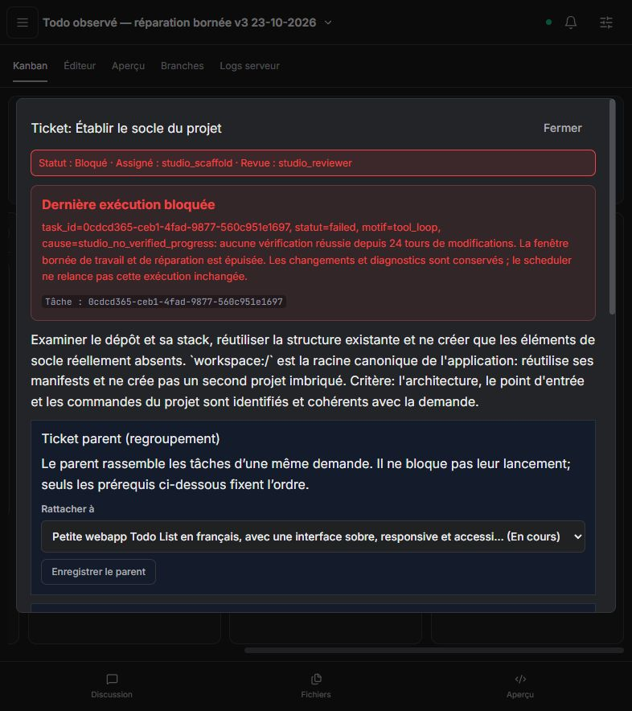

# Recette Todo — Kanban et réparation du build — 23 octobre 2026

## Résultat

**L’autonomie complète n’est pas validée : aucun aperçu utilisable n’a été produit.** Le Kanban est rempli, affiné et utilisé pour confier le socle à son spécialiste ; les autres phases attendent correctement leurs prérequis. La réparation du build reste insuffisante avec les modèles observés, malgré les protections ajoutées et les tests techniques réussis. Les PR restent ouvertes et aucun ticket n’est fermé.

Trois projets neufs ont été observés. Les corrections de Code Studio ont été faites **entre les exécutions arrêtées**, jamais pendant le travail des agents. Aucun fichier de ces projets n’a été corrigé manuellement, aucune consigne supplémentaire n’a été envoyée et aucun build ou aperçu n’a été lancé à leur place. Le modèle est resté sur le profil automatique Studio ; les routes effectivement observées sont Ollama / GPT-OSS 20B et Qwen3.5 9B.

- Interface : `http://127.0.0.1:5179/` ; daemon : `http://127.0.0.1:3876`.
- Dernier daemon testé : `93f7ad5403c31473634af03b3169724817df627a` ; SHA-256 du binaire lancé : `8F2EC684E3D09B7D6ACA71C977C2963C5FF7AF4743FD0D5B41F00F9537A684DA`.
- Interface et contrat de recette au lancement final : `b0e5c2739d6f35bc9a5fba605f56aa4beec616bc`.
- Livraison : [Akasha #259](https://github.com/azerothl/Akasha/pull/259) et [Code Studio #114](https://github.com/azerothl/Akasha-code-studio/pull/114).
- Dépendances conservées : **Akasha #258 → #259 ; Code Studio #113 → #114**, avec le daemon #259 disponible avant l’interface #114.

## Corrections livrées

1. **Identité du ticket initial protégée.** Le moteur attribue `initial_backlog_root` ; les outils ne peuvent pas définir ce champ. Copier le critère `initial-kanban-backlog` ne transforme plus un ticket de validation en nouveau coordinateur. La migration concerne les anciennes demandes chat sans parent ni clé de phase. Les mises à jour agent préservent le parent des phases et leurs prérequis canoniques ; le dispatch de planification vérifie également les prérequis.
2. **Diagnostic de vérification conservé.** Le premier build/test encore en échec conserve sa commande et un extrait borné de sa sortie dans l’état repris. Le moteur les réinjecte à chaque tour. Une autre commande réussie ou une installation ne suffit pas à effacer cet échec.
3. **Réparation encadrée.** Après des inspections sans réparation, le catalogue est réduit. Si un bundler désigne une entrée locale absente, le tour impose une écriture sur ce chemin exact. Le schéma et un contrôle avant exécution refusent un autre chemin ; le modèle fournit toujours le contenu. Le moteur ne génère pas le code applicatif à sa place et conserve les contrôles de permissions et de versions.
4. **Commandes npm corrigées.** Les raccourcis non ambigus `npm build/check/typecheck/lint` deviennent `npm run …`, avec une explication dans le résultat et contrôle préalable du manifeste et du script. Les variantes d’une même commande partagent leur identité de vérification. Une commande identique déjà échouée est refusée avant de démarrer un processus tant qu’aucune mutation ni installation de dépendances réussie ne justifie sa répétition.
5. **Fenêtre de réparation bornée.** Un premier véritable échec de vérification tardif peut bénéficier d’une réserve de 12 tours après son diagnostic, dans une limite totale de 36 tours sans vérification depuis la première modification. Les nouvelles erreurs ne renouvellent pas cette réserve. Un autre test réussi ne réinitialise pas le budget d’un build toujours en échec. Le plafond global et l’interdiction de redispatch inchangé restent en place.

Ces protections contrôlent l’exécution et les preuves. Elles ne garantissent pas que le modèle applique la bonne correction de code.

## Validations techniques

| Validation | Résultat |
|---|---|
| Daemon CPU, `--no-default-features --features embedded --lib` | **700 réussites, 1 test ignoré** ; test PTY ignoré sous Windows |
| Interface, tests unitaires | **41 réussites** |
| Interface, Playwright avec API simulée | **52 réussites** |
| Compilation de l’interface | Réussie ; avertissement existant sur la taille des bundles |
| API réelle de création de projet, avant la seconde correction | **1 réussite, 1 test optionnel ignoré** ; création et Git initial propres |
| Recette agentique technique filtrée, dernier binaire | **3 cas réussis**, fournisseur scripté, fichiers et processus réels |

Les trois cas techniques vérifient la création Git, le maintien d’un échec TypeScript malgré un secours Vite réussi, et la réparation d’une entrée manquante. Ce dernier cas exécute un vrai build en échec avec le raccourci npm, conserve son diagnostic pendant les lectures, refuse une écriture au mauvais emplacement, laisse le modèle scripté écrire le bon fichier puis obtient un vrai build réussi. Le contrôleur ne fournit pas le contenu applicatif dans son schéma.

La suite agentique complète n’a pas été revalidée : seul le filtre `build repair|TypeScript build failure` a été exécuté. Le problème de fixture historique sur `tool_choice` du coordinateur, décrit dans la recette précédente, n’est pas présenté comme résolu. Les tests avec fournisseur scripté ne constituent pas une preuve d’intelligence du modèle.

À la consultation de CI précédant ce rapport : tests Rust CPU, backend embarqué Linux et évaluations simulées réussis ; parcours UI du monorepo encore en cours ; runner GPU toujours en attente. Dans Code Studio, Windows réussit et Linux est encore en cours. Le commit de ce rapport peut déclencher une nouvelle CI. Aucune fusion n’est effectuée.

## Demande et protocole réels

Une seule demande par création depuis l’interface : Todo List française, titre obligatoire, ajout, terminer/rouvrir, suppression, filtres Toutes / À faire / Terminées, compteur, état vide, persistance localStorage, clavier et responsive, puis build/tests pertinents et aperçu. Stack choisie : Vite / React / TypeScript.

Observation par lectures API, consultation du Kanban et captures. Daemon reconstruit et redémarré avant chaque nouveau projet, après vérification qu’aucune tâche n’était active. Aucun changement de configuration des modèles. Les journaux et états sont des vues bornées de l’API ; les opérations échantillonnées ont été dédupliquées, sans prétendre constituer une trace exhaustive.

### Exécutions observées

| Projet et version | Planification | Socle et arrêt | État du Kanban |
|---|---|---|---|
| `2e3b5a30…` — daemon `70d0301` ; observation jusqu’à 10:53:21 UTC | Vérifiée ; 5 opérations réussies, 1 échouée ; dernier checkpoint 6 | 21 réussites, 8 échecs ; checkpoint 28 ; `npm build` invalide répété et `index.html` créé sous `public/` ; arrêt sans vérification réussie | 5 tickets : 3 à faire, 1 parent en cours, 1 socle bloqué |
| `9fdfd295…` — daemon `8f6979b` ; observation jusqu’à 11:07:55 UTC | Vérifiée après correction automatique des critères ; 4 opérations réussies, 0 échouée ; checkpoint 4 | 26 réussites, 4 échecs ; checkpoint 29 ; chemins de configuration avec espaces en tête, puis build réel en échec sur `index.html` ; budget épuisé avant le tour de réparation ciblée | Même chaîne de 5 tickets ; les phases suivantes ne sont pas lancées |
| `37d0fc2e…` — daemon `93f7ad5` ; observation jusqu’à **11:18:04 UTC** | Vérifiée ; 6 opérations réussies, 0 échouée ; checkpoint 6 | 21 réussites, 12 échecs ; checkpoint 32 ; composant React produit, mais erreurs TypeScript non résolues ; arrêt `studio_no_verified_progress` | 3 à faire, 1 parent en cours, 1 socle bloqué ; 0 en revue et 0 terminé |

Tous les identifiants complets et les états sont disponibles dans le [relevé JSON](kanban-build-repair-real-2026-10-23.json). Les checkpoints sont les derniers enregistrés ; ils ne désignent pas nécessairement le dernier tour exécuté avant l’arrêt.

### Dernier projet : ce qui fonctionne

- Le coordinateur affine les tickets puis le scheduler lance `studio_scaffold`, sans intervention de l’observateur.
- Le Kanban reste à cinq tickets. Pas de sous-backlog récursif ni de validation lancée avant l’intégration dans les trois recettes. La protection contre un critère réservé copié est également couverte par les tests unitaires.
- Les opérations observées disposent du contexte du projet et des accès nécessaires ; aucune erreur de type `cached/current path denied` n’est observée dans ces traces.
- Les modifications sont conservées et les installations npm peuvent réussir. Aucun succès applicatif ni build réussi n’est inventé. Après le blocage, aucune nouvelle exécution du projet n’est apparue pendant la fin d’observation ; le daemon reste disponible.

### Dernier projet : ce qui bloque

Le build `npm run build --prod` remonte notamment :

```text
src/App.tsx(47,44): error TS2367: ... types 'string' and 'number' have no overlap.
src/App.tsx(130,3): error TS1117: An object literal cannot have multiple properties with the same name.
tsconfig.json: erreurs TS5092, TS1136 et TS1012.
```

L’agent avait aussi produit un `tsconfig.json` avec deux objets racines. Il en réécrit ensuite une version structurellement plausible, mais continue à relire et retravailler cette configuration plutôt que de corriger les deux diagnostics du composant et de rafraîchir le build. Le dernier diagnostic enregistré provient de la révision 6, alors que l’état final atteint la révision 8 : la réparation doit mieux imposer le cycle modification → nouvelle vérification.

La réserve pour premier échec tardif n’est pas nécessaire sur ce troisième cas : le premier vrai échec est enregistré au tour 15, suffisamment tôt dans la fenêtre normale commencée au tour 9. Cette recette ne démontre donc pas son efficacité avec un vrai modèle ; elle est couverte par les tests de bornes. De même, la réparation ciblée d’une entrée Vite ne peut pas être atteinte tant que la compilation TypeScript échoue auparavant.

Huit fichiers sont visibles, dont `src/App.tsx`, mais ni `index.html` à la racine ni `src/main.tsx`. Aucun aperçu ne tourne. Les fonctionnalités, la persistance, le clavier, le responsive et le respect du design ne sont pas validés en exécution. La revue et les phases suivantes ne sont pas exercées.

## Améliorations encore nécessaires

1. **P0 — Réparation guidée par les diagnostics du compilateur.** Extraire fichier, ligne et code d’erreur ; cibler une lecture courte puis une correction attestée sur le fichier concerné. Après une mutation, imposer une nouvelle vérification avant de répéter des corrections fondées sur une sortie périmée. Les erreurs du composant doivent être traitées, pas seulement celles de la configuration.
2. **P0 — Socle Vite valide et validation des configurations.** Fournir un squelette minimal versionné au choix de la stack, ou des jalons mécaniques équivalents pour manifeste, configuration, `index.html`, entrée et `.gitignore`. Refuser les écritures de configuration structurellement invalides avec un diagnostic exploitable, en prenant en charge JSONC pour TypeScript. L’agent conserve la responsabilité des fonctionnalités Todo.
3. **P1 — Arguments d’outils mal formés.** Prévenir les chemins de manifestes avec un espace initial et adapter le choix d’outil au type de fichier. Les erreurs `write_code` sur JSON/configuration consomment encore des tours alors que `write_file` est disponible. Ajouter les variantes effectivement observées aux recettes de non-régression.
4. **P1 — État agrégé du projet dans le chat et le tableau de bord.** Le parent reste « en cours » alors que son exécution de planification est terminée et le socle bloqué. Le tableau de bord propose encore d’examiner le diff puis l’aperçu. Afficher le blocage du spécialiste, son diagnostic courant et les jalons non atteints.
5. **P1 — Qualification des modèles sur un parcours complet.** Compléter le test de compatibilité native par un petit scénario réel de création, compilation et réparation. La réussite d’une sonde d’outil ou d’une fixture déterministe ne suffit pas à qualifier un modèle pour le mode automatique de développement.


