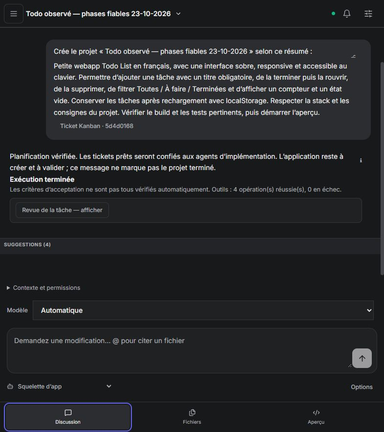

# Kanban et passage à l'implémentation — recette réelle du 23 octobre 2026

**Planification et dispatch observés avec de vrais modèles ; livraison autonome toujours non validée.** Les agents ont précisé les tickets existants, le scheduler a lancé des spécialistes et l'un d'eux a produit des fichiers React. Aucun build, test applicatif, verdict de revue ou aperçu jouable n'a été obtenu dans la fenêtre observée.

## Livraison Git et versions

- [Akasha #259](https://github.com/azerothl/Akasha/pull/259) : `704d1d8` (références et validation du plan), `a032efe` (responsables des phases, titres non bloquants, réparation JSON), puis `79abc43` (ne pas invalider rétroactivement un plan après l'échec d'un worker).
- [Code Studio #114](https://github.com/azerothl/Akasha-code-studio/pull/114) : `cf30869` (message de planification distinct de la livraison) et `feb671d` (spécification).
- Ordre conservé : Akasha #258 → #259 ; Code Studio #113 → #114, après disponibilité du daemon #259. Aucune fusion ni fermeture de ticket.

Le premier binaire observé correspond à `704d1d8`, SHA-256 `DBCE61982F0846B3922DFA6E1125F83DFB940CE46466D3EBC30F7355F22128F7`. Le second correspond à `a032efe`, SHA-256 `EBE0AB3CDB592A30882EA6B9A4406A1641A041FEFC85648128C45A84008E6DC0`.

**Le dernier correctif `79abc43` a été testé et poussé après le relevé du défaut de statut. Il n'est pas chargé dans le daemon de cette recette et n'a pas été rejoué avec le LLM.** Le daemon n'a pas été redémarré pendant les exécutions ou l'attente d'une décision de prolongation. Il reste démarré ; ses activités ultérieures ne sont pas assimilées aux résultats du relevé.

## Corrections

1. Le parent des mutations du coordinateur initial vient du lien tâche / ticket enregistré. Les outils retournent les IDs et les clés des phases. Un parent inexistant proposé par le modèle est remplacé par ce parent connu ; un autre parent existant est refusé.
2. Une création répétée avec la clé d'une phase affine le ticket canonique. Les créations supplémentaires sont refusées tant que les phases restent génériques. Les clés des phases sont stables ; aucun rapprochement approximatif de titres n'est employé.
3. Des critères spécifiques peuvent conserver les critères de socle et les titres initiaux. Une modification cosmétique du titre ne conditionne plus le dispatch. Les seules copies automatiques de la demande ne suffisent pas à qualifier le plan.
4. Le moteur conserve les responsables des phases : `studio_scaffold` pour le socle, `studio_fullstack` pour les trois autres phases et `studio_reviewer` pour la revue. Le coordinateur ne peut plus s'affecter ces travaux par erreur.
5. La fin de planification est contrôlée depuis le board : phases précisées, critères présents, rôles, prérequis internes et absence de cycle. Un travail prêt est requis à l'admission de ce jalon. Deux tours de réparation sont possibles avant un échec explicite.
6. `kanban_plan`, `initial_plan_ready` et `planning_verified` attestent uniquement ce jalon. Ils ne produisent ni acceptation applicative, ni statut `done`, ni preuve d'écriture de code. Le scheduler peut ensuite choisir le premier spécialiste prêt.
7. Les rejets Ollama `error parsing tool call` restent réparables comme les autres erreurs de protocole, sans mettre globalement en quarantaine un transport qualifié. Les arguments incomplets ne sont pas exécutés.
8. Après la recette, la validation structurelle d'un plan a été séparée de la disponibilité actuelle de ses travaux : un worker bloqué ne doit pas transformer une planification réussie en exécution applicative incomplète (`79abc43`).

## Validations techniques

| Contrôle | Résultat |
| --- | --- |
| Daemon sans fonctionnalités par défaut, suite complète | 681 réussis, 1 ignoré ; rejoué sur `79abc43` |
| LLM | 107 réussis, avec les deux familles d'erreurs de protocole dans la régression de quarantaine |
| Interface | 38 tests unitaires réussis ; build TypeScript / Vite réussi |
| Playwright ciblé | 6 réussis : jalon de planification, reconnexion, reprise au rechargement, contexte et suivi |
| CI interface sur `feb671d` | Réussie sur Ubuntu et Windows |
| CI dernier daemon au relevé JSON | En cours pour Rust ; compilation embarquée Linux réussie ; GPU smoke en attente |

Le build UI conserve son avertissement préexistant de taille du bundle. Les tests portent notamment sur le parent inventé, la réutilisation d'une phase, la conservation des responsables, les références étrangères, les cycles, les titres inchangés et la réconciliation après échec d'un worker. Ces contrôles ne constituent pas une preuve de livraison avec un modèle réel.

## Méthode

Deux projets neufs ont été créés depuis l'interface, chacun avec la même demande initiale : Todo française Vite / React / TypeScript, ajout avec titre obligatoire, terminer / rouvrir, suppression, filtres, compteur, état vide, localStorage, interface sobre, responsive et accessible, vérifications puis aperçu. Profil automatique : GPT-OSS 20B primaire, Qwen 3.5 9B en secours, fenêtres configurées à 32 768 tokens.

**Aucune intervention pendant les passages observés** : pas de message supplémentaire, de fichier applicatif modifié à la main, de reprise manuelle, de changement de modèle, de prolongation du budget ou de redémarrage du daemon. Les premières corrections et le second binaire ont été publiés entre deux états bloqués, sans tâche active. Les reprises ultérieures sont celles du scheduler. Les vues, captures et lectures d'API sont des observations.

Les relevés sont datés en UTC dans le JSON ; la date de ce rapport est celle de Paris. Le premier point bloquant du second projet a été enregistré à 23:47:57 UTC. Le premier projet a ensuite été suivi jusqu'à la demande humaine à 96 tours, à 23:53:59 UTC. Un relevé de publication supplémentaire conserve les reprises apparues après ces points d'arrêt, sans prétendre que toute l'activité automatique future est terminée.

## Projet A : reprises, plan prêt, puis fichiers réels et limite de tours

Projet `6847b26e-b76d-423f-8fe7-237b5b672f93` — « Todo observé — handoff Kanban 23-10-2026 ».

- Passage initial `e1e263c3-c6d6-4c71-b613-f2b7ff5fc990` : une lecture du Kanban réussit ; des appels natifs invalides et un JSON incomplet arrêtent le passage avant une mise à jour.
- Reprise automatique `21e800eb-bdad-4b99-bc0e-e8387c4168cf` : six appels réussis et un en échec ; les critères sont enrichis sans recréer les phases, mais le modèle affecte le coordinateur à deux travaux et conserve les titres initiaux. Le défaut de contrat et le contrôle cosmétique du titre sont corrigés entre les passages bloqués.
- Après démarrage du binaire `a032efe`, le scheduler reprend seul avec `917d8951-e6d5-4ef2-8736-da20f03cf02a` : cinq appels réussis, un en échec puis réparation ; `planning_verified=true`, `acceptance_verified=false`. Le tableau reste à cinq tickets.
- Le scheduler lance `studio_scaffold`, tâche `5a296496-7632-45e6-b4c4-c4c79bda9f8f`. Des fichiers réels apparaissent : `package.json`, `index.html`, configurations Vite / TypeScript, `src/App.tsx`, `src/main.tsx`, CSS et déclarations Vite, en plus des trois fichiers initiaux.
- Le worker multiplie les écritures / réparations et atteint 96 tours. Le checkpoint indique `waiting_tool_round_limit` et l'API expose la question de prolongation. Aucune réponse n'a été envoyée. L'API de tâche porte encore `running` à ce point : ce libellé ne signifie pas qu'une génération continue pendant l'attente humaine.

Aucun refus d'accès observé dans ce passage ; les écritures ont bien été exécutées par l'agent. Cela ne certifie ni leur cohérence finale ni leur compilation. Le registre de récupération expose seulement des opérations récentes : son nombre d'entrées n'est pas présenté comme le total des écritures. Aucun build, test applicatif ou aperçu n'est établi au point bloquant.

## Projet B : passage automatique réussi, puis saturation du contexte

Projet `fbc49a96-7819-4242-bc9c-828222b3ccc6` — « Todo observé — phases fiables 23-10-2026 », créé avec `a032efe`.

1. Le coordinateur `1a6a8a5b-3e84-49ab-a0e3-22f4df79f2a6` précise les quatre phases : quatre outils réussis, zéro en échec ; plan vérifié à 23:46:12 UTC. Le tableau compte cinq tickets, sans phase dupliquée. Le chat indique explicitement que l'application reste à créer et valider.
2. Le scheduler lance le spécialiste `studio_scaffold`, tâche `9dc5a189-1db7-4116-abef-2abb25dbdc2b`, sur le ticket de socle. Il ne redéclenche pas la planification à cette étape.
3. Une route GPT-OSS est alors en quarantaine après un HTTP 500 ; Qwen prend le relais et appelle `list_tools`. Il y a donc bien une génération et une opération réussie, pas zéro appel au modèle.
4. L'élargissement au catalogue natif complet porte l'entrée estimée à **30 784 tokens** pour une fenêtre de **32 768**. Avec la marge de sécurité, le garde local ne conserve pas les **512 tokens minimum** de réponse et refuse le tour suivant sur les deux routes. Il ne s'agit pas d'une preuve que le texte d'entrée seul dépasse 32 768 tokens, ni d'un nouveau refus d'accès disque. Aucun contenu applicatif n'est créé par ce spécialiste.
5. Le ticket de socle devient bloqué avec `studio_routes_exhausted`. Son checkpoint et ses événements conservent les détails ; la même demande de ce spécialiste n'est pas relancée aveuglément.
6. Le défaut de réconciliation invalide ensuite le ticket global malgré la planification réussie. Il provoque une nouvelle planification `84a4d963-a0ce-4a78-ab65-f66d2c92deda`, qui ajoute trois tickets de fonctionnalités : le tableau passe à huit tickets. Cette reprise termine avec un nouveau plan vérifié et un autre travail est lancé au relevé de publication. Ce comportement observé appartient au binaire `a032efe` ; sa cause est corrigée dans `79abc43`, testé séparément et non déployé pendant les passages en cours.

La trace de chat reste attachée à la première tâche : elle ne reflète pas à elle seule les spécialistes et reprises du projet. Aucune livraison n'est déclarée validée à partir du seul texte « Exécution terminée ».

## Améliorations restantes

1. **P0 — Découverte d'outils bornée par le contexte.** Éviter que `list_tools` élargisse systématiquement le schéma à tout le catalogue. Permettre une découverte par nom / famille, calculer le coût avant expansion et garder une réserve de réponse. Vérifier le parcours réel découverte → lecture → écriture → build aux fenêtres prises en charge, sans retirer silencieusement les instructions protégées. Contournement de configuration : une fenêtre plus grande peut être essayée si la mémoire disponible le permet ; elle n'a pas été changée pendant la recette et ne constitue pas une correction de cette expansion.
2. **P0 — Progrès vérifiable avant prolongation.** Détecter les réécritures répétées du même socle et le manque de passage aux vérifications. Les extensions doivent dépendre de nouveaux jalons observés, avec un budget global du projet, et non du seul nombre d'appels réussis. Une limite à 96 tours borne le traitement mais ne le rend pas productif.
3. **P1 — Suivi agrégé et diagnostic de blocage.** Relier le chat au ticket global, aux spécialistes et aux reprises ; afficher les blocages descendants et l'attente humaine. Distinguer succès d'outil, erreur de protocole avant exécution, fin d'un passage et acceptation de l'application.
4. **P1 — Contrats des tickets supplémentaires.** Les phases canoniques conservent leurs rôles, mais les tickets découverts ensuite peuvent encore recevoir un reviewer inexistant avant réparation. Valider les noms de rôles dès la mutation et vérifier leurs vrais prérequis pour empêcher un travail de contourner un socle bloqué.

## Preuves

- [Mesures, versions, snapshots des tâches et CI](kanban-handoff-real-2026-10-23.json).
- Capture du jalon vérifié dans le projet B, avant les reprises ultérieures :

