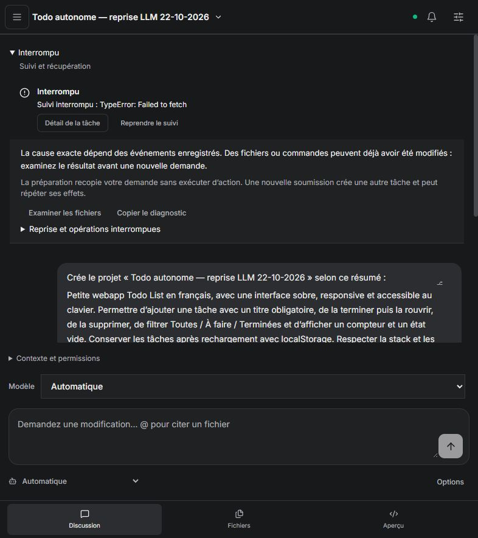
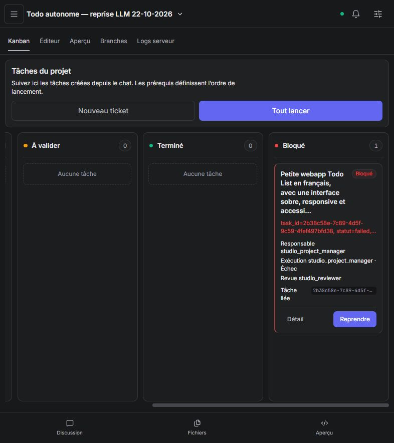

# Todo List : observation avec les modèles réels — 22 octobre 2026

## Périmètre et résultat

**Résultat : blocage fournisseur, aucune application livrée.** L'observation s'arrête à l'escalade humaine émise automatiquement par Code Studio. Ce résultat ne valide pas la création autonome d'une Todo List.

Le projet neuf `Todo autonome — reprise LLM 22-10-2026` a été créé depuis l'interface sur `http://127.0.0.1:5179/`, avec la stack Vite / React / TypeScript, rôle automatique et routage automatique existant. Une seule demande a été soumise via le résumé de création : ajout avec titre obligatoire, terminer / rouvrir, suppression, filtres, compteur, état vide, localStorage, interface française sobre et accessible, vérifications puis aperçu.

Après le lancement : aucune nouvelle consigne, modification de fichier, relance de tâche, changement de modèle ou redémarrage de service. Seuls les états du serveur, les fichiers et les vues de suivi ont été lus. Aucun bouton de reprise n'a été activé.

- Projet : `fe5939a4-20b0-491d-9f5a-5a74e56f7927`.
- Tâche : `2b38c58e-7c89-4d5f-9c59-4fef497bfd38`.
- Ticket racine : `356dac91-34dd-4de0-9411-98c3ea232d32`.
- Début : 21:36:09 UTC ; échec : 21:41:10 UTC, soit environ 300 secondes.
- Daemon : commit `a8ca497`, SHA-256 `53ca2a6c0650e58a3c2958269e0976428e52ad120eb67fab306e8406cad6240c`, compilé avec `--no-default-features --features embedded`.
- Interface : commit `b5e75db`, intégrant la dépendance Code Studio #113.

## Jalons observés

| Jalon | Résultat et limite |
| --- | --- |
| Demande initiale dans le Kanban | Réussi : un ticket coordinateur et quatre sous-tickets, critères de besoin et chaîne de dépendances avant tout travail applicatif. |
| Coordination et spécialisation du backlog | Coordinateur `studio_project_manager` lancé ; le modèle échoue avant toute action. Les sous-tickets restent les gabarits initiaux, sans affinage propre à Todo. |
| Premier modèle réel | `ollama / lfm2:24b` échoue après 16,4 s : `LFM2 tool generation incomplete; nothing executed`. Aucun fragment incomplet exécuté. |
| Repli automatique | La même tâche passe à `akasha_core / core`, sans intervention ; cette route locale embarquée ne répond pas dans le temps restant, environ 283,5 s. |
| Observabilité serveur | 19 heartbeats ; tentatives, routes et erreurs enregistrées. Aucun événement `first_meaningful_progress` ne prétend qu'un travail utile a eu lieu. |
| Suivi navigateur | Échec : `Suivi interrompu : TypeError: Failed to fetch`, alors que le serveur continue. Le chat n'a ensuite pas récupéré automatiquement l'état terminal. L'origine du premier échec réseau n'est pas établie par cette observation. |
| État terminal et rapport | Réussi : racine `blocked`, quatre sous-tickets `todo`, aucune carte active à 100 %, rapport `done: []`, `acceptance_verified: false`, escalade humaine explicite. Aucun autre travail actif lors de la dernière lecture. |
| Droits et outils | 0 appel d'outil réussi ou échoué. Aucune erreur d'accès observée, mais les droits ne sont pas exercés : leur fonctionnement n'est pas validé par ce scénario. |
| Livraison | Aucun fichier applicatif, test, build ou aperçu produit. Seuls les documents et métadonnées initiaux existent. Design, comportements Todo, délégation et reprise après modification restent non vérifiés. |

Le budget fournisseur est annoncé à 299 s dans le diagnostic et le temps total de tâche est d'environ 300 s. Le dernier événement de progression serveur vaut encore 100 %, mais l'issue est explicitement un échec ; le Kanban ne présente pas ce nombre comme un travail achevé.

## Améliorations à traiter

1. **P0 — Qualifier les modèles pour les outils de développement.** Vérifier le protocole d'outils, le contexte et la latence avant d'admettre une route dans le profil Studio. Une disponibilité déclarée ne suffit pas. Ajouter un petit test réel reproductible pour chaque modèle officiellement pris en charge.
2. **P0 — Rendre le repli utile au scénario.** Choisir une route qualifiée pour le rôle et les ressources disponibles, borner aussi l'attente du premier résultat utile et éviter les nouvelles tentatives du scheduler sur une route identiquement défaillante. Le repli observé existe, mais n'a pas récupéré la tâche.
3. **P1 — Reconnecter automatiquement le suivi.** Un échec de lecture ne doit pas remplacer le statut métier par `interrupted`. Conserver le dernier état connu, afficher « suivi momentanément indisponible », réessayer avec temporisation, puis récupérer événements et résultat terminal sans nouvelle demande.
4. **P1 — Adapter le diagnostic à la route.** L'erreur de `akasha_core` évoque un délai HTTP et `base_url`, alors que cette route exécute le modèle embarqué. Exposer le moteur réel, une cause établie et une action de sélection / reprise cohérente ; ne pas supposer un incident réseau ou un manque de mémoire sans preuve.
5. **P1 — Couvrir ces deux échecs dans la recette de livraison.** Ajouter le parcours « échec temporaire de polling pendant une tâche active », ainsi qu'un test réel petit modèle → outils → Kanban → vérification → aperçu. Les tests simulés de reprise ne remplacent pas ce jalon.

## Publication et validations techniques

- [Akasha #259](https://github.com/azerothl/Akasha/pull/259), base #258.
- [Code Studio #114](https://github.com/azerothl/Akasha-code-studio/pull/114), base #113, dépendant du daemon #259.
- Ordre : Akasha #258 → #259 ; Code Studio #113 → #114, avec #259 disponible avant #114.
- Validation locale de l'interface après intégration : 35 tests unitaires, build et 5 parcours navigateur ciblés réussis.
- Autres validations et limite connue de la recette générale : [rapport de reprise](provider-recovery-2026-10-22.md).
- CI au relevé suivant le blocage : Code Studio Ubuntu et Windows réussis ; Akasha Rust, evals et compilation llama.cpp réussis, UI E2E et GPU encore en attente.

Les PR restent ouvertes. Aucun ticket n'est fermé sur la base de ce scénario en échec.

## Preuves

- [Mesures et états structurés](todo-real-llm-2026-10-22.json).
- Capture du chat après l'échec :

- Capture de la carte bloquée après finalisation :

