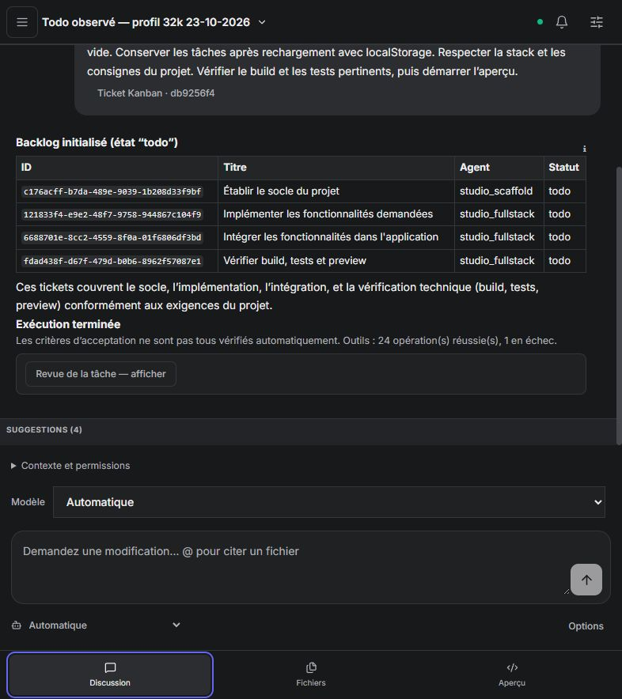
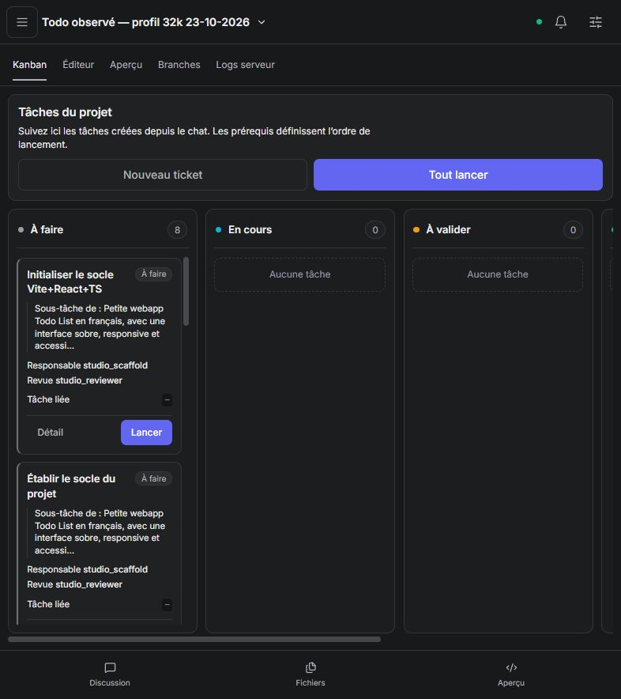
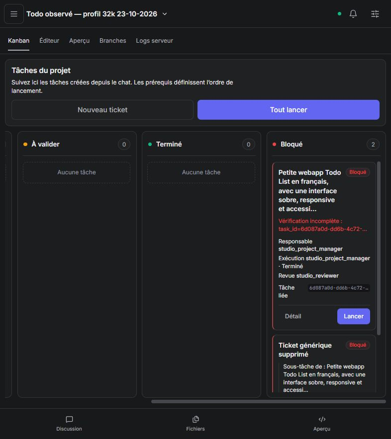

# Todo List avec modèles réels — bilan du 23 octobre 2026

**Résultat : livraison autonome non validée.** Le dernier projet utilise réellement le Kanban et reprend automatiquement sa planification, mais reste bloqué avant l'implémentation. Aucun aperçu Todo jouable n'a été produit.

## Corrections publiées

- [Akasha #259](https://github.com/azerothl/Akasha/pull/259) : qualification inerte des outils, profil Studio dédié, exclusion des secours incompatibles avant la limite de tentatives, attente bornée, quarantaine des erreurs de transport, réparation des erreurs de protocole liées au rôle et arrêt des redispatchs identiques après épuisement des routes. Code testé : `690442a`.
- [Code Studio #114](https://github.com/azerothl/Akasha-code-studio/pull/114) : reconnexion automatique du suivi, contrôle du modèle depuis le composeur, contrat limité à fournisseur + modèle, diagnostics distinguant erreur d'outil, refus de contexte d'une route et panne supposée. Code testé : `05047d0`.
- Ordre conservé : Akasha #258 → #259 ; Code Studio #113 → #114, avec #259 disponible avant #114. Aucune fusion ni fermeture de ticket.

Validations techniques : **37 tests UI, 107 tests LLM et 188 tests Studio** réussis ; build UI et compilation daemon réussis. Les **51 parcours Playwright** ont réussi au passage complet ; la CI de l'interface est également réussie sur Ubuntu et Windows pour `05047d0`. La CI CPU d'Akasha est réussie pour `690442a` ; `gpu-smoke` reste en attente. Ces résultats ne constituent pas une validation de l'autonomie.

La recette daemon avec fournisseur HTTP scripté a été rejouée sur le binaire final : deux scénarios réussis, y compris abandon du flux partiel, repli et reprise du même task_id / ticket. La recette d'accès ciblée vérifie le coordinateur sans écriture applicative et un objectif explicite sur `studio_fullstack`, sans élargir les permissions. La suite agentique générale entière n'a pas été rejouée. Voir les [preuves techniques](studio-admission-reconnection-2026-10-23.md).

## Méthode d'observation

Chaque essai utilise un projet neuf et une seule demande initiale identique : Todo française Vite / React / TypeScript, ajout avec titre obligatoire, terminer / rouvrir, suppression, filtres, compteur, état vide, localStorage, interface sobre, responsive et accessible, puis vérifications et aperçu.

**Aucune intervention pendant les exécutions** : aucun message supplémentaire, modification de fichier, reprise manuelle, changement de modèle ou redémarrage du daemon. Les changements de code et de configuration entre les essais ont été faits après leur état terminal, puis publiés avant le suivant. Les anciens projets ont été conservés.

Les lectures d'API, vues du navigateur et captures n'ont servi qu'à observer. Le dernier essai a été suivi jusqu'au blocage, puis pendant une reprise automatique et jusqu'au nouveau blocage sans tâche active. L'observation s'arrête à ce relevé ; le daemon et son scheduler restent démarrés et leurs éventuelles tentatives ultérieures ne sont pas évaluées par ce rapport.

## Les trois essais

| Essai | Projet / tâche initiale | Observation |
| --- | --- | --- |
| 1 — Qwen, avant correction du filtre | `5810e103-30dd-42be-b1ec-7e1d027c6887` / `a7abc086-e13e-44b2-b001-0e4f9ebae258` | Appel `delegate_to_agent` non annoncé pendant la planification ; refus avant exécution. Les secours embarqués occupaient les places avant GPT-OSS. Échec en une dizaine de secondes, aucun outil du projet exécuté. Le filtre a ensuite été corrigé et couvert par un test. |
| 2 — Repli corrigé, fenêtres différentes | `00d359cc-92fb-4eab-8b91-6a7f38e9b9cb` / `c6fb3f80-c355-4233-bb33-81a4cb6a6c23` | Un appel au Kanban réussi. GPT-OSS est bien considéré, mais le contexte estimé à environ 15 445 tokens ne tient pas dans sa fenêtre de 16 384 avec les réserves. Échec partiel. Le message généralisant ce refus à tous les appels a été corrigé ; l'ancien texte déjà enregistré reste une preuve historique du défaut. |
| 3 — GPT-OSS primaire, deux routes à 32k | `2daf95e8-dded-4440-a499-c66f97742af1` / `476de4d7-16e7-4185-90e8-a850694d366d` | 24 appels d'outils réussis et un en échec selon le bilan de tâche. Le Kanban passe de 5 à 9 tickets, avec critères Todo détaillés, mais conserve des doublons. Le passage termine avec `acceptance_verified=false` et le ticket global devient bloqué. |

Dans le dernier essai, le scheduler relance seul le coordinateur après son délai de cinq minutes : tâche `6d087a0d-dd6b-4c72-b5d1-d0304af4871c`, même ticket global et même Kanban. Ce passage compte quatre appels réussis et deux en échec, puis termine à nouveau sans critères validés. Le registre contient notamment un `studio_create_ticket` refusé avec **`parent_ticket_not_found`**. Le modèle conserve pourtant une synthèse « Backlog initialisé ».

Le profil du dernier essai utilise GPT-OSS 20B en primaire et Qwen 3.5 9B en secours, tous deux à 32 768 tokens configurés. GPT-OSS a réussi son probe réel à cette fenêtre en 11 214 ms. Il s'agit d'un contrôle du petit protocole d'outils, pas d'une mesure de capacité à livrer le projet ni de mémoire GPU disponible.

## État au relevé final

| Jalon | Résultat |
| --- | --- |
| Backlog dès la création | Oui : racine et quatre phases avant les premières générations. |
| Utilisation réelle du Kanban | Oui : lectures, créations et mises à jour avec GPT-OSS. Les critères couvrent les comportements Todo, l'intégration, les tests et l'accessibilité. |
| Unicité / qualité du backlog | Insuffisante : dix tickets au relevé final, dont trois tickets de socle et un ticket « générique supprimé » toujours présent et bloqué. |
| Reprise autonome | Observée : nouveau passage planifié sur le même ticket, sans consigne humaine. Elle n'a pas débloqué l'implémentation. Ce n'est pas une reprise du même task_id après une écriture interrompue. |
| Statuts honnêtes | Le rapport conserve `done: []` et signale les critères non vérifiés. Les tâches du coordinateur portent toutefois `completed` / `succeeded` alors que le projet n'est pas livré. |
| Suivi du chat | Pas de coupure réseau observée pendant le dernier essai. Le chat reste sur la première tâche « Exécution terminée » pendant la reprise planifiée : il ne suit pas l'activité globale du projet. La reconnexion réseau est vérifiée séparément par les parcours simulés. |
| Implémentation / revue | Aucun spécialiste d'implémentation lancé au relevé ; zéro ticket terminé, huit à faire, deux bloqués, aucune tâche active. |
| Droits de développement | Aucun refus d'accès observé, mais les outils de fichiers et de commande n'ont pas été atteints par le scénario réel. Leur utilisation autonome reste non validée ici. |
| Fichiers / vérifications / aperçu | Uniquement `.akasha-studio-tickets.json`, `CODE_STUDIO_PLAN.md` et `DESIGN.md` dans l'arbre exposé. Aucun code applicatif, test, build ou aperçu produit. Design et comportements Todo restent non vérifiés. |

## Améliorations suivantes, par priorité

1. **P0 — Encadrer la transformation du backlog.** Faire adapter les tickets semés au lieu de recréer leurs équivalents. Fournir des références stables au ticket courant, injecter le parent connu côté serveur, retourner les IDs valides après `parent_ticket_not_found` et proposer une vraie fusion / mise à l'écart des tickets obsolètes. Un titre « supprimé » ne retire pas le ticket du travail ouvert.
2. **P0 — Rendre explicite le passage planification → implémentation.** Vérifier mécaniquement qu'un backlog cohérent est prêt, distinguer ce jalon de l'acceptation de l'application, puis dispatcher le premier spécialiste éligible. Une synthèse du modèle ne doit pas valider une planification contenant des erreurs non résolues. En cas de blocage, exposer sa cause exacte plutôt qu'un simple état « incomplet ».
3. **P1 — Suivre l'activité du projet dans le chat.** Relier la conversation au ticket et à ses tentatives / spécialistes ; afficher la reprise automatique et son délai, même après la fin de la tâche initiale.
4. **P1 — Qualifier pour la demande réelle.** Présenter séparément « petit protocole vérifié » et « contexte de cette tâche compatible ». Réduire les réponses volumineuses du Kanban et les instructions répétées par phase, et vérifier la fenêtre des replis après ajout de l'historique récent. La fenêtre de 16k du deuxième essai était un paramétrage de recette insuffisant, pas une panne externe.
5. **P2 — Réinterpréter les diagnostics historiques depuis les résultats structurés.** Les nouveaux messages corrigent les généralisations de refus de contexte, mais les textes déjà enregistrés peuvent encore contredire leurs compteurs. Afficher aussi les erreurs d'outils détaillées dans le résumé de blocage et distinguer clairement « passage terminé » de « projet terminé ».

## Preuves

- [Mesures structurées et états des trois essais](todo-real-llm-2026-10-23.json).
- La conversation reste sur la première tâche pendant la reprise :

- Le Kanban conserve plusieurs tickets de socle :

- État bloqué après la reprise :

