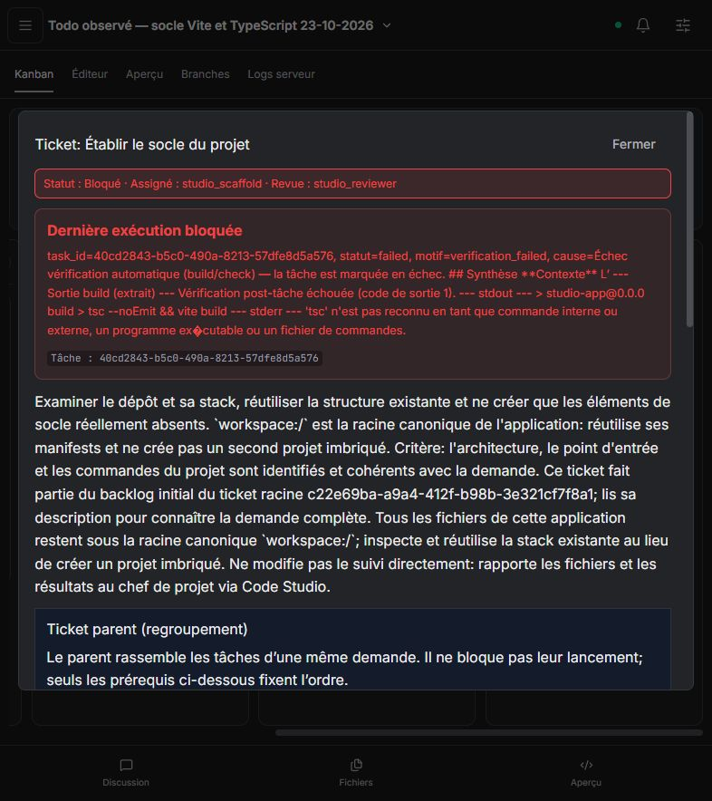

# Recette Todo — socle Vite et réparation TypeScript, 23 octobre 2026

## Résultat

**Les corrections sont poussées ; l'autonomie complète reste en échec.** Le nouveau projet est bloqué au socle, sans aperçu actif. La planification et le dispatch automatiques fonctionnent. Le build post-tâche échoue faute de dépendances installées, puis son ancien réparateur altère des fichiers sources sans résoudre ce prérequis. Aucune correction manuelle du projet testé n'a été effectuée.

- Akasha : PR [#259](https://github.com/azerothl/Akasha/pull/259), commit `e94494fe253f7a7988adf4d16ac4d900e8766be1`.
- Code Studio : PR [#114](https://github.com/azerothl/Akasha-code-studio/pull/114), code et recette au commit `10e445c21eaf0b7483690f1483fdcfff83a18df9` ; rapport ajouté ensuite.
- Dépendances conservées : Akasha #258 → #259 ; Code Studio #113 → #114 ; daemon #259 avant UI #114. PR laissées ouvertes, aucun ticket fermé.
- [Preuves JSON](typescript-vite-real-2026-10-23.json) et [capture finale](typescript-vite-real-2026-10-23.png).

## Corrections livrées

1. **Socle versionné à la création Vite / React / TypeScript.** Manifeste et verrou npm, TypeScript strict, HTML racine, montage React, composant d'attente, `.gitignore`, notice `STUDIO_SCAFFOLD.md`. Initialisation avant le premier commit Git, sans écraser de fichiers ni migrer les imports. Les fonctionnalités Todo restent à implémenter par les agents.
2. **Cycle de réparation TypeScript dans la boucle principale.** Extraction d'un diagnostic local fichier/ligne/code ; lecture du fichier concerné, modification ciblée, puis relance exacte du build avant toute nouvelle correction. Contraintes dans le schéma natif et à l'exécution, état restauré depuis le checkpoint. Les erreurs de modules/types manquants gardent les outils d'installation disponibles.
3. **Configurations préservées avant écriture.** Validation JSONC des configurations TypeScript/JavaScript racines, y compris après un patch ou une modification partielle. Les commentaires et virgules finales valides restent acceptés ; les doubles objets racines et les documents invalides sont refusés sans modifier les octets précédents. Les noms de manifestes accidentellement entourés d'espaces sont également refusés.
4. **Dépendances actualisées.** Vite 6.4.5, Vitest 5.0.5, Node `^22.12.0 || ^24.0.0 || >=26.0.0`. Verrou du socle testé après installation. Code Studio reçoit aussi les mises à jour compatibles de ses dépendances et une substitution DOMPurify 3.4.17 pour la dépendance exacte de Monaco. Les audits npm locaux du socle et de Code Studio signalent chacun zéro vulnérabilité à cette date. Cela n'est pas une garantie permanente d'absence de vulnérabilité.

Les versions précédentes sont notamment concernées par les avis officiels [Vite sur Windows](https://github.com/vitejs/vite/security/advisories/GHSA-fx2h-pf6j-xcff) et [Vitest UI](https://github.com/vitest-dev/vitest/security/advisories/GHSA-5xrq-8626-4rwp). Ces avis décrivent leurs propres conditions d'exploitation ; la mise à jour ne signifie pas qu'une exploitation a été observée ici.

## Validations techniques avant observation

| Validation | Résultat | Portée |
|---|---|---|
| Daemon Rust CPU | 703 réussis, 1 ignoré | Test PTY ignoré ; sans CUDA |
| Outils Rust | 39 réussis | Validation JSON/JSONC des quatre mutations, fichier intact après refus |
| Code Studio unitaires | 41 réussis | Nouvelle version Vitest |
| Code Studio navigateur | 52 réussis | API daemon simulée |
| Build Code Studio | Réussi | Avertissement connu sur la taille d'un paquet |
| Création via daemon réel | 1 réussi, 1 ignoré | Initialisation du projet/Git ; pas une recette LLM |
| Socle isolé, installation et build | Réussis | Véritable npm, TypeScript et Vite |
| Audit npm socle et UI | 0 / 0 | État des dépendances à cette date |
| Intégration agentique ciblée | 4 réussies | Vrais fichiers/processus ; fournisseur **scripté** |

Filtre : `Vite scaffold|build repair|TypeScript build failure`. Binaire : SHA-256 `BE258346CE0B7D1911BA3241E36481B318B464C82D691BE4F1654125CE042DCB`.

La nouvelle recette technique installe le socle et obtient un build initial réussi. Elle introduit ensuite une erreur de comparaison string/number et une propriété d'objet dupliquée. Elle vérifie le ciblage du composant, le refus d'une lecture hors cible et d'une commande de vérification différente, la relance du compilateur entre les deux corrections et le build final réussi. Une écriture de configuration à deux racines est refusée ; son contenu initial reste intact. La recette précédente d'entrée manquante et le refus d'un faux succès Vite après échec TypeScript passent également.

La suite agentique complète n'a pas été revalidée. Le problème historique de fixture du coordinateur décrit dans les rapports précédents n'est pas déclaré corrigé. Ces quatre tests ne prouvent pas l'autonomie d'un vrai modèle.

Lors de la consultation finale précédant la publication du rapport, les contrôles CPU, embarqué Linux, évaluations simulées et UI du monorepo réussissent ; les deux contrôles Code Studio Linux/Windows réussissent. Le contrôle GPU reste en attente. Le commit du rapport peut déclencher une nouvelle CI.

## Protocole réel sans intervention

- Projet neuf `589c6dde-2f51-45d9-b752-f50b70a9ed45`, créé depuis Code Studio sur `http://127.0.0.1:5179/`.
- Demande unique : Todo française, titre obligatoire, ajout, terminer/rouvrir, suppression, filtres, compteur, état vide, persistance localStorage, clavier, responsive, build/tests pertinents et aperçu. Stack Vite / React / TypeScript.
- Daemon et interface redémarrés **avant** création, après contrôle de l'absence de tâches actives. Profil automatique inchangé. Les résultats enregistrent des générations réelles avec Ollama GPT-OSS 20B et Qwen3.5 9B.
- Pendant l'exécution : lectures des états et journaux, consultation du Kanban, captures. Aucun message supplémentaire, lancement manuel, installation, build, correction de fichiers, reprise, changement de modèle ou redémarrage.
- Après l'arrêt : lecture des fichiers et comparaison des empreintes, sans exécution du projet. Observation figée à **11:54:21 UTC**, après plusieurs relevés stables sans tâche active. Le daemon reste disponible.

## Déroulement observé

| Jalon | Observation |
|---|---|
| Création, 11:44 UTC | Socle présent ; cinq tickets créés avec leurs prérequis |
| Planification terminée vers 11:46 UTC | Coordinateur `d06bf45b…` : 10 opérations réussies, 0 échouée ; planification vérifiée |
| Dispatch, 11:47:13 UTC | `studio_scaffold`, tâche `40cd2843-b5c0-490a-8213-57dfe8d5a576`, lancé automatiquement |
| Boucle principale | Lectures répétées des fichiers existants ; dernier checkpoint 23 ; aucun lancement npm observé dans les échantillons |
| Vérification post-tâche | Trois résultats `project_build` échoués avec `tsc` introuvable ; deux tentatives annoncées de correction automatique |
| Réparation ancienne | Appels texte de patchs invalides, modifications hors sujet, réécriture des entrées React ; le prérequis npm reste absent |
| Arrêt détecté, 11:52:30 UTC | `verification_failed` ; socle bloqué ; phases fonctionnalités, intégration et validation non lancées |
| État final | 3 tickets à faire, 1 parent en cours, 1 bloqué ; 0 en revue, 0 terminé ; aperçu inactif |

Le compteur principal du spécialiste affiche 22 opérations réussies et 1 échouée, mais les opérations de la réparation post-tâche apparaissent séparément dans le registre. Les échantillons contiennent notamment des échecs `apply_patch`, `edit_file` et `search_replace` supplémentaires. Ces compteurs ne décrivent donc pas toute l'activité de réparation. Le JSON contient des vues bornées dédupliquées, pas une trace exhaustive.

### Ce qui fonctionne effectivement

- Kanban initial rempli, tickets conservés, prérequis respectés et spécialiste lancé par le scheduler.
- Socle et verrou créés par le moteur, accès aux fichiers sans erreur `cached/current path denied` dans les traces observées.
- Manifeste, verrou npm, TypeScript strict et HTML racine encore identiques au socle à la fin.
- Échec du build signalé ; aucun aperçu ni résultat applicatif n'est déclaré validé par le moteur. Le texte du modèle qui annonce un passage en revue ne suffit pas à le réaliser.

### Ce qui échoue encore

Le diagnostic final est :

```text
> tsc --noEmit && vite build
'tsc' n'est pas reconnu en tant que commande interne ou externe
```

Le relevé final confirme l'absence de `node_modules` et du binaire TypeScript local. Le projet n'a donc pas atteint la compilation de son code. La présence de dépendances dans le manifeste ne garantit pas leur installation.

L'ancien réparateur post-tâche dans `crates/akasha-daemon/src/api.rs` utilise encore une boucle de réponses texte sans les schémas natifs ni le contrôleur persistant ajouté à la boucle principale. Il tente de réparer les sources alors que l'erreur relève de l'environnement. À la fin, `src/App.tsx` commence par `--file_text 'import …` et `src/main.tsx` contient un import non cité : les sources ont été détériorées par la réparation automatique. Des fichiers de suivi apparaissent aussi sous `src/`, en dehors de leur emplacement canonique.

Le cycle TypeScript renforcé est validé par la recette scriptée, **pas par ce parcours réel**. Celui-ci est bloqué avant son déclenchement et passe par un autre réparateur. Aucune fonctionnalité Todo, persistance, accessibilité, qualité visuelle ou reprise réussie après incident n'est validée en exécution.

## Améliorations proposées à partir de ce test

1. **P0 — Prérequis npm mécaniques avant build.** Pour un projet avec verrou fourni, faire exécuter une installation contrôlée avant la première vérification. Une erreur d'exécutable déclaré manquant doit déclencher l'installation bornée, puis la même vérification. Une erreur réseau/registre doit remonter sa cause et un contournement explicites ; elle ne doit jamais déclencher une réécriture React.
2. **P0 — Un seul moteur de réparation.** Faire passer la vérification post-tâche par le même contrat natif, la même classification environnement/source, le même état persistant et le même cycle lecture → modification → vérification. Inclure ses opérations dans les compteurs et les reçus du résultat final. Couvrir ce chemin précis par un test sans `node_modules`, puis une recette LLM réelle.
3. **P0 — Arrêter les réparations mal formées avant mutation.** Refuser les préfixes d'arguments comme `--file_text` dans les sources et éviter la perte de guillemets du protocole texte. Après un patch de syntaxe invalide, proposer un outil typé approprié ; ne pas répéter le même format sans changement. Protéger les fichiers de suivi canoniques contre leur recréation sous `src/`.
4. **P1 — Reconnaître un socle déjà fourni et limiter les relectures.** Vérifier ses jalons techniques plutôt que réinventer ses entrées ou relire plusieurs fois les mêmes fichiers. La fonctionnalité métier doit rester une phase distincte, avec sa propre preuve de réalisation.
5. **P1 — État agrégé et diagnostic lisible.** Le parent ne doit pas rester visuellement en cours lorsqu'un prérequis bloque tous les spécialistes. Présenter d'abord « dépendances non installées », l'installation attendue et la commande échouée, avec un encodage Windows correct et sans synthèse tronquée.


