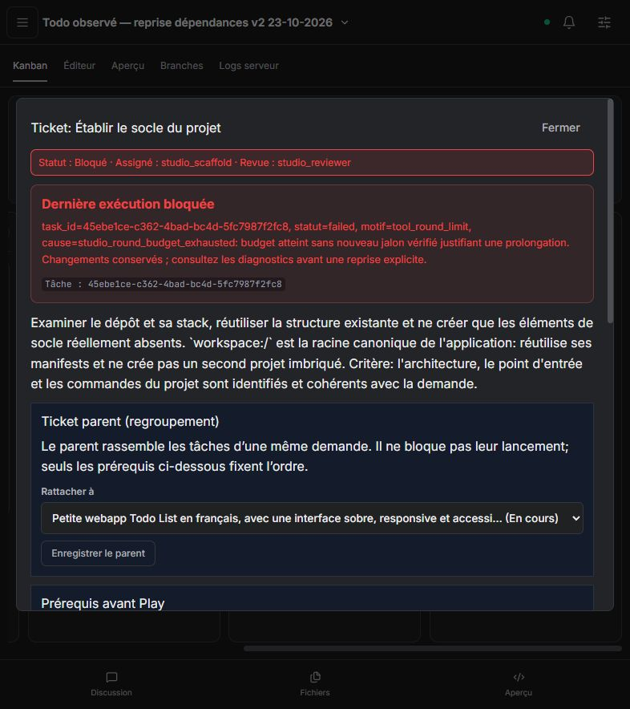

# Installation npm et réparateur unifié — 23 octobre 2026

## Résultat

**La livraison autonome d'une Todo List reste non validée.** L'installation préalable fonctionne et une reprise réelle a réparé un conflit npm dans la boucle native. Les agents n'ont toutefois livré aucune Todo exploitable et aucun aperçu n'a démarré. Les PR restent ouvertes ; aucun ticket n'est fermé sur cette recette.

Code publié avant les essais correspondants :

- [Akasha #259](https://github.com/azerothl/Akasha/pull/259) : `4d27349`, puis `c10ba68` pour la réparation des conflits de dépendances.
- [Code Studio #114](https://github.com/azerothl/Akasha-code-studio/pull/114) : `8d55af0`, puis `a03e138` pour les contrats et recettes.
- Ordre conservé : Akasha **#258 → #259**, Code Studio **#113 → #114** ; daemon #259 disponible avant UI #114.

## Corrections apportées

- Avant une commande npm de build, test ou vérification : installation automatique des dépendances de développement dans le même circuit d'exécution. Utilisation de `npm ci` avec verrou cohérent, sinon `npm install` ; empreinte des manifestes pour invalider une installation périmée.
- Suppression du réparateur LLM post-tâche et des contournements affaiblissant la vérification TypeScript. Une seule boucle conserve les outils, permissions, compteurs, checkpoints et preuves de vérification.
- Une vérification réussie devient périmée après modification des sources. Une installation réussie n'atteste jamais le build.
- Les échecs réseau, authentification ou disque interrompent le build avec diagnostic npm et piste de résolution. Un conflit `ERESOLVE` est traité comme une incohérence du manifeste à réparer : relecture, modification ciblée de `package.json`, puis nouvelle installation, au maximum trois tentatives. Aucun recours automatique à `--force` ou `--legacy-peer-deps`.
- Refus des contenus sources pollués par les marqueurs d'arguments `--file_text`, `--content` ou `--file-content`.

## Validations techniques

| Périmètre | Résultat | Limite |
| --- | --- | --- |
| Tests bibliothèque daemon CPU, mode embedded | 705 réussis, 1 ignoré | Test PTY ignoré ; CUDA non validé |
| Tests unitaires UI | 41 réussis | Sans modèle réel |
| Playwright UI | 52 réussis | API simulée |
| Build UI | Réussi | Avertissement existant de taille du bundle |
| Création de projet sur daemon réel | 1 réussi, 1 ignoré | Exécuté avant le complément ERESOLVE ; ne teste pas le LLM |
| Recettes agentiques filtrées | 7 réussies | Fournisseur scripté, vrais fichiers et processus ; suite complète non rejouée |

Filtre agentique : `unified repair|dependency preparation|Vite scaffold|build repair|TypeScript build failure`. Les cas couvrent notamment l'installation automatique, une erreur TypeScript suivie d'un nouveau build, un véritable conflit de versions Vitest/UI puis sa réparation, l'arrêt après une erreur de registre et le refus d'un faux succès via un build affaibli.

Binaire final : SHA-256 `9DA91C8CB9E51AA34FC5106FD753ED67B04CD50DDDDFC981077AC2A9FAB607C7`, construit depuis `c10ba68`. Avant publication de ce rapport, CI CPU Akasha et CI UI Linux/Windows réussies ; `gpu-smoke` toujours en attente. Le commit du rapport déclenche une nouvelle CI UI.

## Protocole réel

Deux projets neufs, un seul message de création par projet, profil Automatic Studio inchangé avec les vrais modèles Ollama GPT-OSS 20B et Qwen3.5 9B. Demande : Todo List française, ajout/validation/réouverture/suppression, filtres, compteur, état vide, localStorage, interface responsive et clavier, vérifications puis aperçu.

Pendant les exécutions : **aucune modification manuelle du projet, aucun prompt supplémentaire, aucune installation, commande de build, relance ou ouverture d'aperçu manuelle**. Les reprises du scheduler sont restées autonomes. Les corrections du produit et redémarrages ont eu lieu entre des exécutions terminales ; aucun agent actif n'a été interrompu. Le socle Vite fourni par Code Studio appartient au démarrage du projet ; il ne constitue pas l'implémentation des fonctions Todo.

Les lectures d'observation sont bornées ; elles ne constituent pas une trace exhaustive de tous les événements. Les instantanés et contrôles disque sont datés dans le [JSON associé](unified-repair-real-2026-10-23.json).

## Observations

| Exécution | Résultat observé |
| --- | --- |
| Projet `e79e0951-3ea5-4a90-8269-14571e7b08dc`, code `4d27349` | Planification et dispatch réussis. Installation automatique réussie, puis véritable build TypeScript/Vite réussi. Les modifications de tests rendent ensuite cette preuve périmée. Test sans environnement DOM, puis ajout de `@vitest/ui` 3 incompatible avec Vitest 5 : arrêt `ERESOLVE`. Spécialiste : 38 appels réussis / 11 en échec. |
| Projet neuf `748ad178-e733-418d-bf9d-b86fe3b7106e`, code final `c10ba68` | Planification réussie, spécialiste lancé. 61 appels réussis / 3 en échec, arrêt au budget de 64 tours. Les traces capturées montrent essentiellement des lectures répétées ; aucune installation, mutation ou vérification exécutée. Le socle reste inchangé. |
| Reprise automatique du premier projet, tâche `2a5065b2-8af4-4cc8-87ac-3f71ad61c1f9` | Démarrée avec l'ancien binaire, avant le complément ERESOLVE. 6 appels réussis / 2 en échec ; même conflit npm. Aucun retry demandé par l'observateur. |
| Reprise automatique du premier projet, tâche `b15eb635-714b-4e2c-8686-6205f778bc92`, code final | Conflit npm repris dans le contrôleur natif : diagnostic, relecture du manifeste, réparation puis installation réussie. Le build suivant échoue sur les types de test, notamment `toBeInTheDocument`, et une configuration Vitest sous `src/`. 59 appels réussis / 5 en échec, budget de 64 tours atteint sans nouveau build réussi. |

Le contrôle disque final retrouve Vitest et son UI installés en version 5.0.5 dans le premier projet, mais son manifeste déclare à nouveau `@vitest/ui: ^3.2.4`. La réparation a donc fonctionné à un instant donné sans garantir la cohérence finale du projet. Les entrées `src/App.tsx` et `src/main.tsx` des deux projets restent celles du socle : aucune fonctionnalité Todo livrée.

Dans chaque projet, le Kanban contient cinq tickets : trois à faire, un parent en cours, un spécialiste bloqué, aucun terminé ni en revue. La création du backlog et le dispatch sont effectifs ; le suivi du parent masque encore le blocage de son spécialiste. Le scheduler borne ses reprises à trois échecs, avec attente croissante : les reprises observées ne sont pas une boucle infinie.

À la coupe finale du 23 octobre à 12:46:42 UTC, les tâches capturées sont terminales et les aperçus inactifs. Les fonctionnalités, la persistance, l'accessibilité et le design d'une application Todo ne peuvent donc pas être déclarés validés.

## Améliorations restantes

1. **P0 — Détecter l'absence de progression avant la première écriture.** Borner les relectures d'un fichier dont le contenu ne change pas, puis imposer un jalon utile ou arrêter avec un diagnostic de stagnation. Le budget actuel autorise encore une exploration répétitive de 64 tours.
2. **P0 — Reconnaître et valider le socle déjà fourni.** Faire passer le spécialiste à l'implémentation une fois les entrées et commandes vérifiées ; éviter de consacrer tout le budget à la redécouverte du projet ou aux tests d'une application encore absente.
3. **P0 — Stabiliser l'environnement de tests.** Une configuration DOM cohérente, des types jest-dom effectivement chargés, une configuration Vitest unique et des versions compatibles doivent être vérifiés avant l'installation et après chaque modification du manifeste. Empêcher la réintroduction d'un conflit déjà réparé.
4. **P1 — Rendre les reprises compréhensibles.** Afficher tentative, délai et motif, distinguer attente de reprise et blocage définitif ; refléter le blocage du spécialiste sur le parent.
5. **P1 — Qualifier les modèles sur la progression réelle.** La capacité à appeler un outil ne suffit pas. Ajouter une petite recette création → modification → build → réparation et un repli contrôlé lorsqu'un modèle stagne malgré des outils valides.

Ces points sont des suites proposées, pas des correctifs inclus ou validés par cette livraison. Les preuves techniques confirment l'installation et le circuit de réparation ; elles ne prouvent pas encore l'autonomie de bout en bout.
